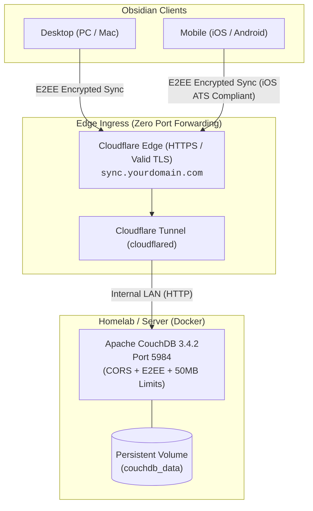

# Self-Hosted Obsidian LiveSync Stack

A turn-key, production-ready template to deploy **[Obsidian Self-hosted LiveSync](https://github.com/vrtmrz/obsidian-livesync)** using **Apache CouchDB** and **Cloudflare Tunnels**.

Enables real-time, bidirectional synchronization across **Windows, macOS, Linux, Android, and iOS** without port forwarding, dynamic DNS, or recurring subscription fees.

---

## Architecture



### Key Architectural Decisions
- **iOS Compatibility**: iOS App Transport Security (ATS) strictly enforces valid HTTPS certificates for network requests within apps. Cloudflare Tunnels provide free, automatic TLS termination so Obsidian on iPhone connects seamlessly.
- **Zero Port Forwarding**: The server establishes an outbound tunnel to Cloudflare. Your home IP address is never exposed, and no router ports (80/443/5984) need to be opened.
- **End-to-End Encryption (E2EE)**: The LiveSync plugin encrypts all markdown notes on your device using a private passphrase before transmitting them over the network. Even the CouchDB server and Cloudflare only store encrypted ciphertext.
- **Real-Time Keystroke Sync**: Character-by-character conflict merging without Git merge conflict markers.

---

## Quick Start

### 1. Clone and Configure
```bash
git clone https://github.com/charlesterrenal/obsidian-livesync-template.git
cd obsidian-livesync-template

# Copy template environment file
cp .env.example .env
```

Edit `.env` and set a strong password:
```env
COUCHDB_USER=admin
COUCHDB_PASSWORD=choose_a_strong_password_here
COUCHDB_DB=obsidian-livesync
COUCHDB_PORT=5984
```

### 2. Start CouchDB
```bash
docker compose up -d
```

### 3. Initialize Databases
Run the included initialization script to create CouchDB system databases (`_users`, `_replicator`, `_global_changes`) and your vault database:

**On Linux / macOS:**
```bash
chmod +x scripts/init-couchdb.sh
./scripts/init-couchdb.sh
```

**On Windows (PowerShell):**
```powershell
.\scripts\init-couchdb.ps1
```

Verify your server is running by opening `http://localhost:5984/` or running:
```bash
curl http://localhost:5984/
# Output: {"couchdb":"Welcome","version":"3.4.2",...}
```

---

## Cloudflare Tunnel Setup (Public HTTPS)

To allow your mobile devices to sync away from home, route traffic through a free Cloudflare Tunnel.

### Option A: Cloudflare Zero Trust Dashboard (Recommended)
1. Go to [Cloudflare Zero Trust Dashboard](https://one.dash.cloudflare.com/) -> **Networks** -> **Tunnels**.
2. Click **Create a tunnel** (or select your existing tunnel) -> **Configure**.
3. Under the **Public Hostnames** tab, click **Add a public hostname**:
   - **Subdomain**: `sync` (or `livesync`)
   - **Domain**: `yourdomain.com`
   - **Type**: `HTTP`
   - **URL**: `localhost:5984` (or your server LAN IP: `192.168.x.x:5984`)
4. Click **Save hostname**.

### Option B: Local CLI Tunnel Configuration (`config.yml`)
If you manage your tunnel via `/etc/cloudflared/config.yml`:
```yaml
ingress:
  - hostname: sync.yourdomain.com
    service: http://localhost:5984
  - service: http_status:404
```
Then create a `CNAME` record in Cloudflare DNS:
- **Type**: `CNAME`
- **Name**: `sync`
- **Target**: `<your-tunnel-uuid>.cfargotunnel.com`
- **Proxy Status**: Proxied (Orange Cloud)

Test your public endpoint:
```bash
curl -s https://sync.yourdomain.com/
# Output: {"couchdb":"Welcome","version":"3.4.2",...}
```

---

## Obsidian Client Setup

### Step 1: Desktop Setup (Primary Device)
1. In Obsidian desktop, install and enable the community plugin: **Self-hosted LiveSync**.
2. Go to **Settings** -> **Self-hosted LiveSync** -> choose **Manual Setup**:
   - **URI**: `https://sync.yourdomain.com` (ensure no trailing spaces)
   - **Username**: `admin` (from your `.env`)
   - **Password**: Your CouchDB password
   - **Database Name**: `obsidian-livesync`
   - **Use Internal API**: Checked
   - **End-to-End Encryption**: Enabled (choose a secret passphrase)
3. Click **Check server requirements** (all checks should pass green).
4. Under **Initial replication**, select: **Overwrite Server Data with This Device's Files** (makes your desktop the master copy).
5. Once uploaded, press `Ctrl + P` (or `Cmd + P`) -> run:
   ```text
   LiveSync: Copy settings as a new setup URI
   ```
   (This copies the encrypted setup string and generates a QR code).

### Step 2: Mobile Setup (iPhone / Android)
1. Install **Obsidian** on your phone and create an empty vault.
2. In Settings -> **Community plugins** -> install and enable **Self-hosted LiveSync**.
3. When prompted, choose **Use a Setup URI** and scan the QR code from your desktop screen (or paste the URI).
4. Enter your E2EE encryption passphrase.
5. Select **Join this device** -> **Fetch from remote database**.

All notes, folders, and attachments will immediately stream down to your phone.

---

## Syncing Themes, Snippets, and Customizations

To mirror your desktop theme, custom CSS snippets, and icons to your phone:

1. **On Desktop**:
   - In Settings -> **Self-hosted LiveSync** -> open **Customization Sync**.
   - Set a **Device Name** (e.g. `desktop-pc`).
   - Toggle **Enable customization sync** to **ON**.
   - Press `Ctrl + P` -> run: **`LiveSync: Show customization sync dialog`**.
   - Click **Scan changes** -> **Select All Shiny** -> **Apply All Selected**.
2. **On Mobile**:
   - Open Command Palette -> run **`LiveSync: Show customization sync dialog`**.
   - Click **Scan changes** -> **Apply All Selected**.
   - Restart the app.

---

## Security and Hardening Checklist

- [x] **CORS Whitelisting**: `local.ini` restricts CORS origins specifically to `app://obsidian.md`, `capacitor://localhost`, and `http://localhost`. Wildcard `*` origins are blocked when credentials are required.
- [x] **Client-Side E2EE**: All notes are encrypted with AES-GCM before leaving the device. Even if Cloudflare or CouchDB were compromised, notes cannot be decrypted without your passphrase.
- [x] **Document Size Limits**: Configured to `50000000` (50 MB) to accommodate large embedded PDF documents, audio memos, and images.
- [x] **No Inbound Open Ports**: Zero port forwarding on home firewalls.

---

## Troubleshooting

| Issue | Cause | Solution |
| :--- | :--- | :--- |
| `Remote URI and database name could not contain spaces` | Trailing space in URL or Database Name | Delete accidental space at the end of `https://sync.yourdomain.com` or database name. |
| `_users database does not exist` in logs | System DBs not initialized | Run `./scripts/init-couchdb.sh` or `.\scripts\init-couchdb.ps1`. |
| `CORS error` or `Failed to fetch` on Desktop | Web standard restricts wildcard origins with auth | Ensure `local.ini` has explicit origins, and toggle **Use Internal API** in plugin settings. |
| `Replication failed on an unattended path` in logs | Duplicate trigger dropped | Harmless informational log indicating a background sync was already active. |
| Sync conflict dialog appears (`Conflicting changes`) | Simultaneous edits detected | Tap **Use Conflicted** for the newer version, or toggle **Resolve conflicts by newer file** in plugin settings for automated merging. |

---

## License

MIT License. Free to use, modify, and distribute for personal and commercial homelab deployments.
